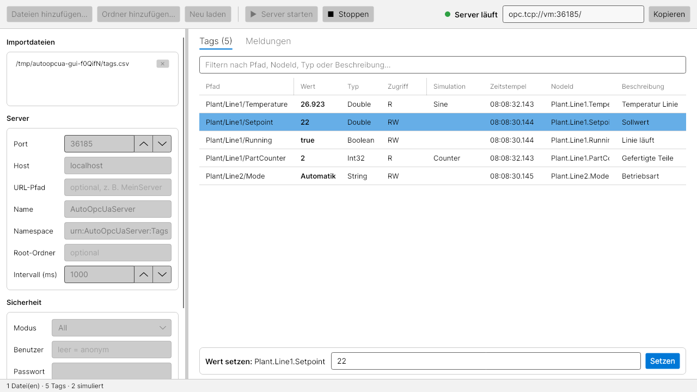

# AutoOpcUaServer

Ein OPC UA Server in C# (.NET 8), der seinen Adressraum automatisch aus **CSV-, Excel- oder JSON-Dateien** aufbaut.
Tagliste importieren, Server starten, mit UaExpert (oder einem anderen Client) verbinden – fertig.

Es gibt zwei Varianten: eine **grafische Oberfläche** (Windows, Linux, macOS) und eine **Kommandozeilen-Version** (z. B. für Skripte, Docker oder als Dienst).



Typische Einsätze: Simulation einer SPS/Anlage für Tests, Entwicklung von OPC UA Clients, Demo- und Schulungsumgebungen.

Basierend auf dem offiziellen [OPC Foundation UA .NET Standard Stack](https://github.com/OPCFoundation/UA-.NETStandard).

## Grafische Oberfläche

Voraussetzung: [.NET 8 SDK](https://dotnet.microsoft.com/download)

```bash
dotnet run --project src/AutoOpcUaServer.Gui
```

1. **Dateien hinzufügen…** / **Ordner hinzufügen…** – oder CSV-, Excel- und JSON-Dateien einfach ins Fenster ziehen.
   Die Tags erscheinen sofort in der Tabelle; Fehler in den Dateien stehen unter **Meldungen** (mit Datei und Zeile).
2. Links Port, Name, Sicherheit und optional Benutzer/Passwort einstellen.
3. **▶ Server starten** – die Endpoint-URL erscheint oben rechts und lässt sich kopieren.
4. Während der Server läuft, zeigt die Tabelle die **Live-Werte** (inkl. Simulation und Schreibzugriffen von Clients).
   Einen Tag auswählen, um seinen Wert unten **manuell zu setzen** – auch bei Read-only-Tags, z. B. um eine SPS zu simulieren.
5. Schreibzugriffe von Clients und Warnungen des OPC-UA-Stacks werden unter **Meldungen** protokolliert.

Dateiliste und Einstellungen (außer dem Passwort) werden gespeichert und beim nächsten Start wiederhergestellt
(`%APPDATA%\AutoOpcUaServer` bzw. `~/.config/AutoOpcUaServer`). Dort liegen auch die Zertifikate der GUI (`pki/`).
Dateien können auch beim Start übergeben werden: `AutoOpcUaServer.Gui.exe tags.xlsx`.

Als eigenständige Anwendung (ohne installiertes .NET):

```bash
dotnet publish src/AutoOpcUaServer.Gui -c Release -r win-x64 --self-contained -p:PublishSingleFile=true -o publish-gui
```

## Kommandozeile

```bash
dotnet run --project src/AutoOpcUaServer -- samples
```

Ausgabe:

```
Imported 17 tag(s) (7 simulated) from 3 file(s).
Server 'AutoOpcUaServer' is running. Endpoints:
  opc.tcp://<hostname>:4840/ [None, None]
  opc.tcp://<hostname>:4840/ [Basic256Sha256, SignAndEncrypt]
  ...
Login: anonymous
Press Ctrl+C to stop.
```

Danach im Client `opc.tcp://localhost:4840` verbinden. Die Tags liegen unter `Objects`.

### Kommandozeilen-Version als eigenständige Anwendung bauen

```bash
dotnet publish src/AutoOpcUaServer -c Release -r win-x64 --self-contained -o publish
```

```bash
publish/AutoOpcUaServer.exe meine-tags.xlsx --port 4840
```

(`-r linux-x64` für Linux.)

## Aufruf

```
AutoOpcUaServer <datei|ordner>... [optionen]
```

Es können mehrere Dateien und/oder Ordner angegeben werden. Bei einem Ordner werden alle unterstützten Dateien darin importiert.

| Option | Beschreibung | Standard |
|---|---|---|
| `-p`, `--port <port>` | TCP-Port | `4840` |
| `--host <name>` | Hostname in der Endpoint-URL | `localhost` (→ Rechnername) |
| `--path <pfad>` | Pfad in der Endpoint-URL, z. B. `MeinServer` → `opc.tcp://host:4840/MeinServer` | leer |
| `-n`, `--name <name>` | Anwendungsname (erscheint im Client und im Zertifikat) | `AutoOpcUaServer` |
| `--namespace <uri>` | Namespace-URI der Tags | `urn:AutoOpcUaServer:Tags` |
| `--root <ordner>` | Alle Tags in diesen Ordner unter `Objects` legen | – |
| `--separator <zeichen>` | Trennzeichen für Ordner im Pfad | `/` |
| `--security <modus>` | `none`, `secure` oder `all` | `all` |
| `--user <user:passwort>` | Login mit Benutzername/Passwort verlangen | – (anonym) |
| `--allow-anonymous` | Anonymen Login trotz `--user` erlauben | aus |
| `--auto-accept` | Client-Zertifikate automatisch vertrauen | aus |
| `--interval <ms>` | Aktualisierungsintervall der Simulation | `1000` |
| `--pki <ordner>` | Ablage der Zertifikate | `./pki` |
| `--quiet` | Schreibzugriffe von Clients nicht protokollieren | aus |
| `--validate` | Dateien nur prüfen, Server nicht starten | aus |

Exit-Codes: `0` OK, `1` Fehler in den Importdateien, `2` falsche Argumente, `3` Server konnte nicht starten.

## Dateiformat

Alle Formate verwenden dieselben Spalten. Groß-/Kleinschreibung ist egal, deutsche Spaltennamen funktionieren ebenfalls.

| Spalte | Alias | Pflicht | Beschreibung |
|---|---|---|---|
| `Path` | `Pfad`, `Tag`, `TagName` | ja\* | Ordnerpfad + Name, z. B. `Anlage/Linie1/Temperatur` |
| `Folder` + `Name` | `Ordner` + `Name` | ja\* | Alternative zu `Path`: Ordner und Name getrennt |
| `DataType` | `Datentyp`, `Typ` | nein | Datentyp (siehe unten), Standard `Double` |
| `Value` | `Wert`, `Startwert` | nein | Startwert. Arrays: Werte mit `\|` trennen (`1\|2\|3`) |
| `Access` | `Zugriff` | nein | `R` (nur lesen) oder `RW` (lesen/schreiben), Standard `RW` |
| `Description` | `Beschreibung`, `Kommentar` | nein | Beschreibung des Knotens |
| `NodeId` | `Id` | nein | Eigene String-NodeId (sonst `Ordner.Unterordner.Name`) |
| `Simulation` | `Sim` | nein | `Random`, `Sine`, `Ramp`, `Counter`, `Toggle` |
| `Min`, `Max` | | nein | Wertebereich der Simulation (Standard 0–100) |
| `Period` | `Periode` | nein | Periodendauer in Sekunden für `Sine` / `Ramp` (Standard 60) |

\* Entweder `Path` oder `Name` (optional mit `Folder`).

### Datentypen

`Boolean`, `SByte`, `Byte`, `Int16`, `UInt16`, `Int32`, `UInt32`, `Int64`, `UInt64`, `Float`, `Double`, `String`, `DateTime`

Zusätzlich verstanden: `bool`, `short`, `ushort`, `int`, `uint`, `long`, `ulong`, `single`, sowie SPS-Typen `REAL` (Float), `LREAL` (Double), `DINT` (Int32), `LINT` (Int64), `WORD` (UInt16), `DWORD` (UInt32).
Ein angehängtes `[]` macht ein Array: `Double[]`, `Int32[]`, …

Zahlen dürfen mit Komma oder Punkt geschrieben werden (`21,5` oder `21.5`). Booleans: `true/false`, `1/0`, `ja/nein`, `on/off`.
`DateTime` im ISO-Format, z. B. `2026-01-01T08:00:00Z`.

### Simulation

| Typ | Verhalten | Datentypen |
|---|---|---|
| `Random` | Zufallswert zwischen Min und Max | Zahlen, Boolean |
| `Sine` | Sinus zwischen Min und Max mit `Period` | Zahlen |
| `Ramp` | Sägezahn von Min nach Max in `Period` Sekunden | Zahlen |
| `Counter` | +1 pro Intervall, springt nach Max auf Min zurück | Zahlen |
| `Toggle` | Wechselt jedes Intervall (true/false bzw. Min/Max) | Zahlen, Boolean |

### CSV

Trennzeichen `;`, `,` oder Tab werden automatisch erkannt. Felder können in `"` stehen. Zeilen mit `#` am Anfang sind Kommentare.

```csv
Path;DataType;Value;Access;Description;Simulation;Min;Max;Period
Plant/Line1/Temperature;Double;21,5;R;Temperatur Linie 1;Sine;15;30;60
Plant/Line1/Running;Boolean;true;RW;Linie läuft;;;;
Plant/Line1/PartCounter;Int32;0;R;Gefertigte Teile;Counter;0;100000;
Plant/Line2/Recipe;Int32[];1|2|3|4;RW;Rezeptschritte;;;;
```

### Excel (.xlsx)

Erste Zeile = Spaltenüberschriften, gleiche Spalten wie bei CSV. Alle Tabellenblätter mit einer `Path`- oder `Name`-Spalte werden importiert, andere Blätter ignoriert. Die Datei darf beim Start in Excel geöffnet sein.

### JSON

```json
{
  "tags": [
    { "path": "Robot/Axis1/Position", "dataType": "Double", "access": "R", "simulation": "Sine", "min": -180, "max": 180, "period": 20 },
    { "path": "Robot/Status", "nodeId": "Robot.State", "dataType": "String", "value": "Idle" },
    { "path": "Robot/Offsets", "dataType": "Float[]", "value": [0.5, 1.0, -0.25] }
  ]
}
```

Statt `{ "tags": [...] }` geht auch direkt ein Array `[...]`.

Beispiele für alle drei Formate liegen in [`samples/`](samples).

## Adressraum

Aus `Plant/Line1/Temperature` wird:

```
Objects
└── Plant                  ns=2;s=Plant
    └── Line1              ns=2;s=Plant.Line1
        └── Temperature    ns=2;s=Plant.Line1.Temperature
```

Der Namespace-Index ist üblicherweise `2`; maßgeblich ist die Namespace-URI (`--namespace`).

Fehler in den Dateien (unbekannter Datentyp, ungültiger Wert, doppelter Pfad, Variable gleichzeitig als Ordner verwendet, doppelte NodeId, …)
werden vor dem Start mit Datei und Zeilennummer gemeldet – der Server startet dann nicht. Mit `--validate` lassen sich Dateien prüfen, ohne den Server zu starten.

## Sicherheit und Zertifikate

- Beim ersten Start wird ein selbstsigniertes Anwendungszertifikat in `./pki/own` erzeugt.
- `--security all` (Standard) bietet sowohl unverschlüsselte (`None`) als auch signierte/verschlüsselte Endpoints (`Basic256Sha256`, `Aes128_Sha256_RsaOaep`, `Aes256_Sha256_RsaPss`).
- Verbindet sich ein Client verschlüsselt, landet sein Zertifikat zunächst in `./pki/rejected/certs`. Zum Vertrauen nach `./pki/trusted/certs` verschieben – oder für Testumgebungen `--auto-accept` verwenden.
- Mit `--user admin:geheim` wird ein Benutzername/Passwort-Login verlangt. Das Passwort wird vom Client immer verschlüsselt übertragen (auch über `None`-Endpoints).

## Entwicklung

```bash
dotnet build
dotnet test
```

Projektstruktur:

```
src/AutoOpcUaServer.Core/       Gemeinsame Bibliothek
  Model/                        Tag-Definition, Datentypen, Wertkonvertierung
  Import/                       CSV-, Excel-, JSON-Importer und Validierung
  Server/                       OPC UA Server, NodeManager, Simulation, Konfiguration
src/AutoOpcUaServer/            Kommandozeilen-Version
src/AutoOpcUaServer.Gui/        Grafische Oberfläche (Avalonia, MVVM)
tests/AutoOpcUaServer.Tests/    Unit-Tests und Integrationstests (echter Client ↔ Server)
tests/AutoOpcUaServer.Gui.Tests/ Headless-Tests der Oberfläche
samples/                        Beispiel-Taglisten
```

Screenshot für die README neu erzeugen:

```bash
GUI_SCREENSHOT=$PWD/docs/screenshot.png dotnet test tests/AutoOpcUaServer.Gui.Tests --filter Main_window_renders
```
